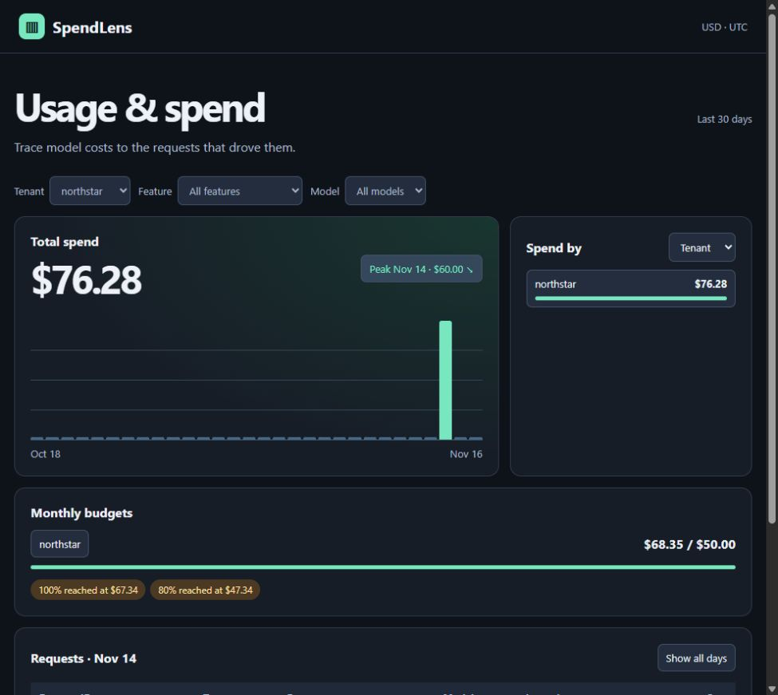

# SpendLens

Track AI spend by tenant, model, and feature. Inspect a daily spike down to individual requests and see which monthly budget thresholds were crossed.



## Run locally

```powershell
docker compose up --build -d
```

Open [SpendLens](http://127.0.0.1:8008/). Compose runs FastAPI, the React dashboard, and PostgreSQL. Demo mode generates 30 days of synthetic usage with fictional rates. No provider credentials are needed.

Select **northstar** under Tenant, then click **Peak**. The three requests on that day use **atlas-pro** for document summarization. The monthly budget shows the recorded 80% and 100% alerts.

## Record your own usage

FastAPI serves the schema and request console at [API docs](http://127.0.0.1:8008/docs). Configure `SPENDLENS_DEMO=0` and a `SPENDLENS_TOKEN` of at least 24 characters in your ignored local `.env` before recording real usage. Use a fresh database to keep real and demo data separate. Send the token as an Authorization bearer header and enter it when opening the dashboard.

| Endpoint | Purpose |
|---|---|
| `POST /api/rates` | Register a model rate for an effective UTC date. `input_rate` and `output_rate` are thousandths of a US dollar per million tokens. For example, `1200` means $1.20 per million. |
| `POST /api/usage` | Supply tenant, request ID, model, feature, timestamp with offset, and input and output token counts. Identical retries return the original charge. A changed payload with the same tenant and request ID returns HTTP 409. |
| `PUT /api/budgets` | Set a tenant budget in USD cents for the first day of a UTC month. Alerts appear in the dashboard at 80% and 100%, once per tenant and month. |
| `GET /api/dashboard` | Return the last 30 days of spend, with tenant, model, and feature filters and a paginated request table. |

Each usage record stores the effective rate date and an integer charge in USD nanounits. Historical costs remain fixed when a new rate is added. The token protects the workspace as a whole. Tenant is a reporting dimension.

For a local run without Docker, create a virtual environment, install `requirements.txt`, run `npm ci` and `npm run build` in `frontend`, then run `python -m uvicorn backend.main:app --port 8008` from the project root. The app uses SQLite unless configured for PostgreSQL. Run `python -m unittest discover -s tests -v` for the workflow checks.
